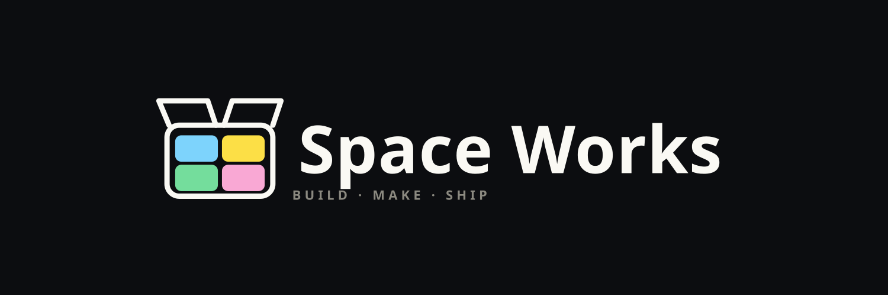

<div align="center">

  

  <h1>Space Works — Open Source Makerspace Manager</h1>

<p>
  Self-hostable, multi-tenant <strong>management platform for makerspaces</strong> — run your
  inventory, tool &amp; equipment lending, and 3D printing in one place. Browse, borrow, track, and
  stay accountable, without spreadsheets.
</p>

<p>
  <a href="LICENSE"></a>
  <a href="https://github.com/SpaceWorks-HQ/SpaceWorks/actions/workflows/release.yml"></a>
  
  <a href=".github/CONTRIBUTING.md"></a>
</p>

</div>

---

Space Works started inside the **TinkerSpace Kochi** community, from a simple need: make it easy for a
makerspace to know **what tools and equipment exist, who borrowed what, what's available, and how
every loan and print job moves from request to done** — with enough traceability that accountability
for shared gear is never a guessing game. It's built by makers, for makers: run it at your space, fork it, remix it, or use it as
a starting point. If your community works differently, make it your own.

One deployment can host **many makerspaces** (tenants). Each owns its inventory, public URL, staff,
Telegram group, QR namespace, and audit scope — fully isolated from the others.

## Features

- **Public catalog** — browse by makerspace and category, request to borrow, and (when enabled)
  **QR self-checkout/return** for present members with photo evidence.
- **Full hardware lifecycle** — request → accept → issue (box QR scan + photo) → return (photo +
  remark) → accountability, all audited. Direct staff handouts too.
- **3D-printing manager** — public print requests, printer/spool management, filament tracking,
  slicer estimates, and an optional (staff-private) cash charge at collection.
- **Events & bookings** — one-off events or recurring series, registration with optional approval and
  waitlists, QR check-in at the door (plus an expiring offline roster and event-scoped PIN stations for
  a desk with no signal), post-event feedback, attendance certificates, printable badges, member
  calendar feeds, and bookable spaces.
- **Organizations across makerspaces** — a network, university or chain registered as an organization
  linked to any number of spaces, with a public profile and a cross-makerspace event catalogue. An
  organization grant confers **actions, never identity**.
- **QR everywhere** — boxes, tools, and individual assets; immutable scan history.
- **Live staff console and one search box** — queues, loans and check-ins update the moment a change
  commits (Server-Sent Events over the deployment's Redis; falls back to polling without it), and every
  inventory, machine and event list answers `?q=` with full-text search that tolerates typos.
- **Editions and a single box** — an events-only or bookings-only installation hides the loan spine it
  does not use (`SPACEWORKS_EDITION`), and the whole application can run as one container beside
  Postgres and Silo object storage when a makerspace has one small server and nobody to operate a stack.
- **Operable in production** — every request carries an `X-Request-ID` through JSON logs and Celery,
  a token-protected Prometheus endpoint reports queue depth, delivery failures and storage, and CI runs
  the whole suite before an image is published.
- **Action-based staff console** — editable per-makerspace roles over a fixed action set, four seeded
  defaults, and a superadmin-only Django control plane.
- **Reports & ledger** — what's out, who has it, overdue tracking, CSV/XLSX export, plus accessible
  charts with table fallbacks and append-only metric rollups where a correction adds a revision rather
  than rewriting history. Every module is covered either by a substantive report or an explicitly
  gated row.
- **Notifications** — per-makerspace **Telegram, Slack, Mattermost and Discord** alerts plus async
  (Celery) email, with a per-feature × per-channel matrix. Each channel is its own module.
- **Modular by install** — turn whole modules on and off per makerspace; uninstalling hides surfaces
  and always keeps the data. See [Modules](#modules).
- **Sign-in options** — username/password, Google, Apple, any OIDC provider (Keycloak, Authentik,
  Azure AD, Okta), and **phone + SMS code** for members. Each is switchable, and a space can run with
  **no member accounts at all**, on your own identity provider plus staff-created walk-in records.
- **Maker profiles** — an opt-in per-makerspace profile with projects, interests, education and an
  optional GitHub contribution count, plus a member directory that lists only the people who chose to
  be listed.
- **Traceable by design** — append-only audit log; attached evidence photo metadata and scan history are immutable. Unused upload slots that no handover ever consumed may be cleaned up under a separate default-off policy — they never formed part of the trail.
  Photo *bytes* can expire under a per-makerspace retention policy, while the photo metadata, remarks,
  scans and audit trail are kept — so the accountability record outlives the image itself, and an
  expired photo reads as a truthful expired state rather than a missing one.

> **What works out of the box:** username/password. Google, Apple and OIDC need credentials you
> create with that provider, and phone sign-in needs an SMS account — none of them can ship
> preconfigured, because they are issued against *your* domain. `setup.sh` walks you through Google
> and you can skip it; password login is unaffected either way. The GitHub contribution count on
> maker profiles is the same shape: set `GITHUB_API_TOKEN` in `.env` to enable it, and leave it unset
> for the section to simply never appear.

## Quick start

Space Works runs entirely through Docker Compose — it brings up **PostgreSQL, Redis, Silo object storage (the maintained, S3-compatible fork of the archived MinIO), the
Celery worker/beat, and database migrations** and wires them to the app for you (the images don't bake
in any addresses; the compose file passes them in). Pick one path:

**Path 1 — Guided pinned install (easiest; no Git clone or local build).** One script checks the host,
downloads the newest published GitHub release built from `main`, generates all secrets, pulls its
published images, and creates your first admin + makerspace:

**Before you start, you need:**

- a 64-bit (x86_64 or arm64) Linux server (Debian/Ubuntu, Fedora/RHEL/Alma/Rocky, Arch or openSUSE),
  macOS, or Windows Git Bash/WSL;
- on Linux, root or a user with `sudo` — the installer installs Docker, Docker Compose, curl and tar
  itself; on macOS/Windows, Docker Desktop installed and running;
- internet access to `github.com` and `ghcr.io`, at least 8 GiB free disk, and TCP ports 80, 9000 and
  9001 free;
- a terminal, plus the answers setup asks for: the web address (host name or IP), your makerspace name,
  and the admin username, email and password (or let it generate one). Google sign-in and Stripe keys
  are optional.

```bash
curl -fsSL https://raw.githubusercontent.com/SpaceWorks-HQ/SpaceWorks/main/install.sh | bash
```

Run it as your normal user — it asks for your `sudo` password when it needs root, adds you to the
`docker` group if required, and leaves the install owned by you. `curl … | sudo bash` also works and
keeps the install (and its update cron job) owned by root. `bash install.sh --help` prints the
checklist without changing anything.

It installs to `/opt/spaceworks`; set `SPACEWORKS_DIR` on the `bash` side of the pipe to override that
(on Windows Git Bash, use `SPACEWORKS_DIR="$HOME/SpaceWorks"`). It detects x86_64/aarch64 and the host
distribution, checks dependencies, Docker, ports, disk space and existing state, then installs missing
Linux dependencies through apt, dnf/yum, pacman or zypper. It verifies release availability before
deploying; the downloaded source and backend/frontend images are pinned to the tagged release.

It prints your URL and login when it finishes and offers to install seven-day, backup-first production
update checks. Installs pin the latest main release; manual updates, the Platform panel and the seven-day
cron move to the newest published, non-draft, non-prerelease main release. Accepted versions are
`X.Y.Z-main.<run>.<12-hex sha>`, with no release channel setting.
Super Admins can control automatic or manual installation from **Platform settings →
Software updates**. `setup.sh` pulls published images by default; developers with a full source checkout
can explicitly opt into a local Django/Vite build with `bash setup.sh --build`.

Run the same curl command later and an existing install shows a menu. It never silently reinstalls or
reruns first-instance setup:

1. **Update to the latest release** — backs up the database, moves to the newest main release, runs
   migrations and restarts. Modules and data stay as they are.
2. **Change modules only** — turn optional modules (events, bookings, machines, membership, payments…)
   on or off without downloading a new version.
3. **Update, then change modules** — option 1 followed by option 2.
4. **Cancel** — exit without changing anything (the default).
An update rerun uses the latest main archive's updater/helpers against the existing install, keeping
its privileged host files in place, so older installers can move onto the main-only update path.

**Path 2 — Manual prebuilt-image setup.** Pull the two published images and start the stack —
after `cp .env.example .env` (fill in the few values it asks for):

```bash
export MAKERSPACE_IMAGE_TAG=latest        # or pin a release, e.g. 0.5.1-main.42.a1b2c3d4e5f6
bash scripts/init-host-orchestration.sh   # one-time root-owned pointer/key/config state
scripts/spaceworks-compose.sh bundled up -d
```

This pulls **`ghcr.io/spaceworks-hq/spaceworks-backend`** + **`ghcr.io/spaceworks-hq/spaceworks-frontend`** and brings up the
full stack automatically.

### Upgrades and module changes

Updates select the newest main release from GitHub. An interactive update reviews the live module ticks
after the new release is healthy. The useful explicit forms are:

```bash
bash scripts/update.sh --force --modules                    # update, then review modules
bash scripts/update.sh --force --no-module-changes          # update images only
bash scripts/update.sh --modules-only --makerspace my-space # modules only; no release check
bash scripts/update.sh --all-modules --without=printing,payments \
  --makerspace my-space --confirm-removals
bash scripts/update.sh --all-modules --all-makerspaces      # explicit cross-tenant target
```

Modules belong to a makerspace through `Makerspace.enabled_modules`, not to the deployment as a whole.
When more than one makerspace exists, select one with `--makerspace <slug>` or deliberately target all
with `--all-makerspaces`; non-interactive updates refuse to guess. `--modules` requests the interactive
tick list, while `--modules-only`, `--all-modules`, `--without=a,b`, `--confirm-removals` and
`--no-module-changes` support explicit operator and automation flows.

Unticking a module hides its surfaces and calls `uninstall_module`; it does **not** delete rows.
`purge_module_data` is a separate destructive command and is never called by setup or update.

### Windows support boundary

- **Tier 1 — native:** install, run and upgrade with Docker Desktop plus Git Bash (or run the bash scripts
  inside WSL). Because native Git Bash normally has no `flock`, the updater falls back to a PID/timestamp
  directory lock, automatically clears a dead owner's lock, and provides `--override-lock` for a verified
  wedged or unreadable owner.
- **Tier 2 — WSL2 required:** in-place restore, backup import and compound host orchestration. Those
  supervisors depend on Linux AF_UNIX sockets and root-owned-file trust semantics with no native Windows
  equivalent; this tier does not have native parity.

## Modules

A makerspace only carries the parts it uses. Space Works ships **35 modules**; **6 are core** and
always on (the public catalogue, request workflow, staff admin, evidence uploads, QR management and
the scanner). The rest are **opt-in**.

Core is not negotiable because the hardware-handover rules depend on it: issuing a tool requires a box
QR scan *and* a photo, so a machines-only workshop still carries the request/QR/evidence spine.

Per-module detail — what each key is and what you lose without it — is in
[**docs/MODULES.md**](docs/MODULES.md).

You do not have to think in 34 switches. They are grouped into **twelve areas**, which is what the
console shows you:

| Area | Covers |
|---|---|
| **Inventory** *(always on)* | The catalogue, request workflow, QR/evidence spine, asset units, containers, transfers, QR print batches, front-desk handover and purchasing |
| **Stocktake** | Scan-first stock counts and variance reporting |
| **Machines** | Machine registry, the service/print queue, maintenance and warranty |
| **Events** | Event scheduling and registrations — recurring series, approval and waitlists, QR check-in at the door, post-event feedback and attendance certificates, member calendar feeds, printable attendee badges, and cross-makerspace collaborative events |
| **Bookings** | Resource booking and public self-booking |
| **Membership** | Join requests, waivers, referrals, member activity, maker profiles, presence — and the member-facing identity ecosystem |
| **Notifications** | The in-app inbox and every outbound channel |
| **Reports** | Analytics, the report registry and CSV/XLSX exports |
| **Payments** | Taking money online, through Stripe or Razorpay |
| **Mobile apps** | Attested device sessions, native push and the in-app payment sheet |
| **Connected devices** | Printers and label printers enrolled with their own signing key |
| **Updates** | In-app release control |

**Pick modules at install time** — `setup.sh` reads the live registry and opens a tick list. Its initial
recommended state corresponds to this profile table; management commands can also pass `--profile`:

| Profile | Modules | For |
|---|---|---|
| `minimal` | 6 | Core only; nothing published publicly |
| `workshop` | 15 | A machine shop: machines, service queue, maintenance |
| `lending` | 18 | A tool library: the full lending lifecycle, no machines |
| `recommended` | 21 | Core plus the inventory lifecycle, reports and machines |
| `cloud` | 25 | A managed box: everything a hosted deployment runs |
| `everything` / `full` | 35 | All modules |

**Change it later.** Uninstalling clears the capability and hides the surfaces; **your data is always
retained** and reinstalling brings it back:

```bash
docker compose run --rm --no-deps backend --role management python manage.py list_modules
docker compose run --rm --no-deps backend --role management python manage.py install_module bookings
docker compose run --rm --no-deps backend --role management python manage.py uninstall_module bookings
```

Core modules cannot be uninstalled, nor can one another installed module depends on.

### Deleting a module's data

Uninstalling only hides. If you also want a module's rows *gone*, that is a separate, deliberate
second step — so that no single command can both hide and destroy:

```bash
docker compose run --rm --no-deps backend --role management python manage.py purge_module_data bookings --list
docker compose run --rm --no-deps backend --role management python manage.py purge_module_data bookings --makerspace my-space
```

- **The module must already be uninstalled.** Purging an installed module is refused.
- **Superadmin only**, and it asks you to type the makerspace slug back before proceeding.
- **It cannot be undone.** Uninstall is reversible; this is not.
- **Payment records are kept.** Switching a module off and deleting its rows is not a reason to
  destroy the record of money that really changed hands, so receipts stay visible and a pending
  charge stays payable and can still be marked paid or waived. Each charge keeps the description it
  was raised under, so it still reads sensibly once the booking or event behind it is gone. Deleting
  a whole makerspace is the exception — there, its payments go with it.
- Uploaded files are removed after the database work commits, and your storage quota is credited
  back only for objects the bucket confirmed it deleted — a failed delete credits nothing, so the
  counter can never drift below what you are actually storing.

A module absent from the list either owns no data of its own or cannot be purged separately, and
the command tells you which. `machines` is the notable second case: machine rows host warranty
records, consumables and service history, so purge `machine_service` first.

### Every module, by area

The full list, so you can see exactly what a profile is turning on. **Core** is always present and
cannot be removed. **Default** means it is on when you install without choosing a profile.

| Area | Module | Core | Default | What it adds |
|---|---|:--:|:--:|---|
| **Inventory** | [`public_inventory`](docs/MODULES.md#public_inventory) | ● | ● | The public catalogue |
| | [`request_workflow`](docs/MODULES.md#request_workflow) | ● | ● | Borrow requests and the state machine |
| | [`staff_admin`](docs/MODULES.md#staff_admin) | ● | ● | The staff console |
| | [`evidence_uploads`](docs/MODULES.md#evidence_uploads) | ● | ● | Issue/return photos |
| | [`qr_management`](docs/MODULES.md#qr_management) | ● | ● | QR codes for boxes, tools and assets |
| | [`scanner`](docs/MODULES.md#scanner) | ● | ● | The camera scanner |
| | [`asset_units`](docs/MODULES.md#asset_units) | | | Individually tracked units of a product |
| | [`containers`](docs/MODULES.md#containers) | | | Boxes and storage containers |
| | [`bulk_import`](docs/MODULES.md#bulk_import) | | | Spreadsheet import |
| | [`stock_transfers`](docs/MODULES.md#stock_transfers) | | | Moving stock, including between makerspaces |
| | [`qr_print_batches`](docs/MODULES.md#qr_print_batches) | | | Printable QR sheets and ZIP export |
| | [`guest_handover`](docs/MODULES.md#guest_handover) | | | Front-desk direct handouts |
| | [`procurement`](docs/MODULES.md#procurement) | | | The "to buy" list |
| **Stocktake** | [`stocktake`](docs/MODULES.md#stocktake) | | | Scan-first stock counts and variance |
| **Machines** | [`machines`](docs/MODULES.md#machines) | | | The machine registry |
| | [`machine_service`](docs/MODULES.md#machine_service) | | | The service/job queue |
| | [`printing`](docs/MODULES.md#printing) | | | 3D printing on top of `machine_service` |
| | [`maintenance`](docs/MODULES.md#maintenance) | | | Scheduled and reactive maintenance |
| **Events** | [`events`](docs/MODULES.md#events) | | | Scheduling, recurring series, registrations and waitlists, QR check-in, feedback and certificates, collaborative events |
| **Bookings** | [`bookings`](docs/MODULES.md#bookings) | | | Resource booking and public self-booking |
| **Membership** | [`membership`](docs/MODULES.md#membership) | | | Join requests, waivers, referrals, maker profiles |
| | [`member_accounts`](docs/MODULES.md#member_accounts) | | | Member sign-up and member sign-in |
| **Notifications** | [`notifications`](docs/MODULES.md#notifications) | | | The in-app inbox |
| | [`email`](docs/MODULES.md#email) | | | Outbound email |
| | [`telegram`](docs/MODULES.md#telegram) | | | Telegram group alerts (outbound only) |
| | [`slack`](docs/MODULES.md#slack) | | | Slack alerts |
| | [`mattermost`](docs/MODULES.md#mattermost) | | | Mattermost alerts |
| | [`discord`](docs/MODULES.md#discord) | | | Discord alerts |
| | [`webhook`](docs/MODULES.md#webhook) | | | Signed JSON webhooks to your own systems |
| **Reports** | [`reports`](docs/MODULES.md#reports) | | | Analytics, the ledger and CSV/XLSX export |
| **Payments** | [`payments`](docs/MODULES.md#payments) | | ● | Taking money online (Stripe or Razorpay) |
| **Mobile apps** | [`mobile`](docs/MODULES.md#mobile) | | | Attested device sessions, native push, payment sheet |
| **Backup & custody** | [`backup`](docs/MODULES.md#backup) | | ● | Makerspace archives, archive-recipient keys and custody status |
| **Updates** | [`updates`](docs/MODULES.md#updates) | | ● | In-app release control |

`mobile` requires `member_accounts`; `printing` requires `machine_service`. Installing one pulls in
what it needs. `membership` deliberately does **not** require `member_accounts` — identity can come
from an external identity provider or a staff-created walk-in record instead.

**Every module has a page.** [**docs/MODULES.md**](docs/MODULES.md) covers each of the 32 keys in turn:
what it is, what it puts on screen, **what happens if you do not install it**, and what becomes of its
data if you later purge it.

### Features: the second level

Some capabilities are narrower than a whole module, so they are **features** inside one. A feature
is only effective when its parent module is on, and unlike modules these are editable by a **Space
Manager** in the console rather than a superadmin.

| Feature | Inside | Default | What it does |
|---|---|:--:|---|
| `payments.enabled` | `payments` | ● | Master switch for all online payments |
| `payments.machines` | `machines` | | Charge for machine jobs |
| `payments.bookings` | `bookings` | | Charge for bookings |
| `payments.events` | `events` | | Charge for event registration |
| `payments.membership` | `membership` | | Charge membership dues |
| `payments.loans` | `payments` | | Raise a deposit when a loan is issued and a capped late fee when it comes back late |
| `mobile.push` | `mobile` | ● | Native push notifications |
| `events.offline_checkin` | `events` | | Expiring on-device roster and event-scoped PIN check-in stations |
| `machines.certifications` | `machines` | | Members need an unexpired certification per machine type to book a linked space or request work; overrides need machine-type authority and are audited |
| `notifications.delegated_recipients` | `notifications` | | Machine-scoped maintainers manage maintenance recipients for their own machines (also needs `maintenance` and `machines`) |
| `inventory.self_checkout` | — | ● | Member self-checkout and staff direct handouts |
| `presence.geofence` | — | ● | Advisory location check at check-in (never blocks) |
| `inventory.kiosk` | — | | Scanner and handover Stations whose online handovers are attributed to a signed-in staff operator |

The four `payments.<area>` switches are **off by default and stay inert until you add credentials** —
turning one on cannot start charging anyone by itself. `inventory.self_checkout` and
`presence.geofence` belong to no module: they are standalone capabilities that apply whenever you
enable them.

### What you get if you choose nothing

Installing without a profile gives you **8 modules**: the six core ones plus `updates` and `backup`.
Member accounts and mobile apps are opt-in; mobile pulls in `member_accounts` when installed.

Everything money-related is still dormant: `payments` being installed means the *surfaces* exist,
and no charge can be created until a Space Manager enables a `payments.<area>` feature **and** valid
Stripe or Razorpay credentials resolve. The same is true of push (needs FCM/APNs), every chat channel
(needs a webhook) and every sign-in method beyond username/password.

### Notification channels are modules

`email`, `telegram`, `slack`, `mattermost`, `discord` and `webhook` are each a module, so a space that lives in
Discord ships no Slack surface at all. Turning a channel's module on never makes it start sending on
its own — you still add the webhook or token, and you still enable the events you want in the
per-feature × per-channel matrix. Turning it off stops delivery but **keeps the stored credential**,
so re-enabling needs no re-entry.

Chat channels are configured **per makerspace** (the space owns the channel and pays for it). Sign-in
providers are the opposite — they resolve before a makerspace is chosen, so they are configured once
for the whole deployment.

### Running without member accounts

Turning **Member accounts** off removes the member-account *ecosystem*: nobody signs themselves up, and the
member area, phone sign-in and the built-in Google/Apple buttons all go with it. It does **not** remove
identity, and it never touches staff sign-in — a deployment that could switch off its own staff logins
could not be administered.

People still get named, two ways:

- **Your own identity provider.** A configured OIDC provider (Keycloak, Authentik, Azure AD, Okta,
  Google Workspace) keeps working, because it is your institution's directory rather than an account
  ecosystem this deployment runs.
- **Walk-ins.** Front-desk staff add someone at the counter from the handout screen. That creates a
  person record — a name, optionally an email and phone — with **no password and no way to sign in**.
  It is enough to issue them a tool, register them for an event or run a machine job for them, and it
  keeps every handover attributable to a real person, which the hardware rules require.

#### Who may ask to borrow something

Borrow requests are only ever a *proposal* — staff still accept them, and staff acceptance is what
reserves stock — so who may submit one is a separate switch from who may sign in. There are three
states, and you never set them both:

| Member accounts | Account-less requests | Who may submit |
| --- | --- | --- |
| on | off | **Members** — an active member of that makerspace |
| off | off | **Account holders** — anyone signed in (the default without the module) |
| off | **on** | **Anyone** — no account at all |

The last row is opt-in per makerspace, and turning **Member accounts** on turns it back off: enabling
membership means asking for membership, so a stranger must not still walk past it. Account-less
submissions ask for a name, email and phone, require an `Idempotency-Key`, and are rate-limited per IP
and per email address; every one of them is recorded against a single shared requester principal, which
is deliberately excluded from every per-person ranking so a hundred strangers never add up to one
fictional "top borrower". `setup.sh` asks this question during first-run setup, and it can be changed
later with `manage.py set_request_access`.

### Choosing which ways in you offer

**`/control/` → Platform login methods** switches the four credential kinds independently: password,
identity provider, phone code, and self sign-up. All four are on by default and switching one off
never deletes anything, so turning it back on needs no re-entry.

Each switch covers **every** way in of that kind, not just the obvious one. Turning passwords off
also refuses a mobile app's device login, which would otherwise mint a long-lived session from the
same password. Turning self sign-up off also stops an identity provider from creating a brand-new
account — signing in on an already-linked account, and linking a provider to an account you already
have, both keep working, because neither is a registration.

Existing sessions are deliberately **not** revoked: a login-method switch is a policy change, not a
revocation. Use the restrict/suspend flow to end someone's access.

Two changes are refused rather than performed, because they cannot be undone from inside the app:
switching off a method that is somebody's *only* credential (they have no password to reset, so
forgot-password cannot rescue them), and switching off passwords while no superadmin has a linked
provider — this page would then be unreachable.

### Rooms: sending different alerts to different places

A chat channel can have more than one **room** — a Slack channel, a Discord channel, a Telegram group.
Add them under **Settings → Notification channels → Rooms**. A room with nothing selected receives
everything; narrow one to a machine, a machine type or an inventory category and it receives only
those alerts. "All the 3D printers, plus the laser" needs no extra concept — the selections are a
union.

Two things worth knowing before you set this up:

- **Webhook URLs are write-only.** They are stored encrypted and never shown again, so an edit that
  only renames a room can leave the field blank.
- **Telegram rooms share the makerspace's bot** — add the same bot to each group and paste each
  group's chat ID. Delivery is outbound only: chat is not a decision surface, so no alert carries
  accept/reject buttons and decisions are made in the staff console or `/control/`.

A makerspace that has added no rooms keeps using the single webhook under **Chat webhooks**, exactly
as before. Nothing changes until you add your first room.

### Choosing who hears about what

By default every alert goes to everyone whose role covers it — a booking alert reaches whoever can
manage bookings. Under **Settings → Notification channels → Who gets notified** you can override that
per event, for events, bookings, maintenance and members. A recipient can be:

| Recipient | Means |
|---|---|
| A role | Everyone currently holding that role |
| A named member | One person, who must be a member of this makerspace |
| All members | The whole membership |
| The person it is about | The requester, booker or registrant |

**Leaving an event empty is the default, not silence** — remove every recipient and it goes back to
notifying by role. A member who has switched their own notifications off is never mailed, even when
somebody selects them.

Recipients can be narrowed by machine or category the same way rooms are, and the narrowing can only
ever *reduce* who is notified: a person is never alerted about a machine their role cannot see.

### Editing the wording

**Settings → Email templates** covers hardware, printing, events, bookings, maintenance and
membership, for both the member-facing and staff-facing message. Each template lists the variables it
can use and previews against sample data, and a saved template can be reset to the built-in wording at
any time. Chat messages have one editable body per event, shared by all four chat channels — so you
edit the wording once rather than four times.

Chat rooms only ever receive the **staff** wording. Member-facing text ("your booking is confirmed")
goes to email and to the member's phone, never into a shared room where everyone with channel access
would see that member's name.

### Removing a module from the build entirely

Uninstalling is per makerspace. A deployment that will *never* use an area can drop its code surfaces
too — no routes, no admin, no OpenAPI paths — while keeping every row and migration:

```bash
docker compose run --rm --no-deps backend --role management python manage.py suggest_tombstones   # prints the line to paste
```

Add the result to `.env` as `TOMBSTONED_APPS=`. It is deliberately conservative: an app is only
suggested when **no** makerspace on the deployment uses any of its modules.

## Documentation

| I want… | Go to |
|---|---|
| What a **module** is and what happens without it | **[docs/MODULES.md](docs/MODULES.md)** |
| A **plain-language, non-technical** walkthrough | **[docs/setup-for-makerspaces.md](docs/setup-for-makerspaces.md)** |
| **Production** reference (env vars, TLS, upgrades, releases) | **[docs/self-hosting.md](docs/self-hosting.md)** |
| **Advanced** config (Telegram, HMAC, Supabase, cron) | **[.github/ADVANCED.md](.github/ADVANCED.md)** |
| **Develop / contribute** (run from source, tests, releases) | **[.github/DEVELOPMENT.md](.github/DEVELOPMENT.md)** |

## Roadmap

Space Works 0.5 is focused on reliable self-hosting and complete makerspace operations:

- automatic, backup-first updates from every successful `main` release;
- stable public, member, staff, and superadmin workflows across the full module set;
- continued accessibility, mobile, reporting, and operational resilience work.

### Planned modules

Not built yet. Listed here rather than in the module table because that table is generated from the
module registry, and the registry only carries modules with real enforcement behind them.

- **Hardware integration** — talking to the machines themselves rather than only recording them:
  reading job state off a printer or CNC controller, driving label printers directly, and door or
  access-control hardware for check-in. Today the machine service queue is operated by hand and
  geofenced check-in is deliberately advisory; this is the module that would change that. It needs a
  device-identity and trust story of its own, because a network device reporting job completion is
  an unauthenticated actor asserting a state transition.
- **Invitation requests** — letting a prospective member *ask* for an invitation, rather than only
  being invited or applying to join.

Current work and shipped changes are tracked in
[GitHub issues](https://github.com/SpaceWorks-HQ/SpaceWorks/issues),
[pull requests](https://github.com/SpaceWorks-HQ/SpaceWorks/pulls), and the release notes. The running
product intentionally does not expose a separate roadmap page.

## Roles & access

See [roles and access](docs/README-HOSTING.md#roles--access) for custom roles, action grants,
and makerspace scoping.

## Hosting

See the [hosting guide](docs/README-HOSTING.md#hosting) for first-run generated credentials,
Docker and split deployments, and moving a makerspace onto its own server.

## Tech stack

Django 6 + DRF · React 19 + Vite 8 + Tailwind CSS 4 + TypeScript (TanStack Query v5) · PostgreSQL 16 ·
Celery + Redis · Silo (S3-compatible MinIO fork) · django-unfold admin · drf-spectacular / OpenAPI. Delivered as
two Docker images (`spaceworks-backend`, `spaceworks-frontend`); everything else is official upstream images.

## Contributing

Space Works is a collaborative project for the makerspace community, and **contributors are very welcome** —
code, docs, translations, or just running it at your space and reporting what's rough. See
**[.github/CONTRIBUTING.md](.github/CONTRIBUTING.md)**. **No CLA is required** — by opening a pull
request you agree your contribution is offered under the project's AGPL-3.0-or-later license
(inbound = outbound); merged contributors are credited in
[.github/CONTRIBUTORS.md](.github/CONTRIBUTORS.md).

## License

Space Works is **free and open source software**, licensed under the
**[GNU Affero General Public License v3](LICENSE)** (`AGPL-3.0-or-later`).

You are free to use, study, share, and modify Space Works — for **any** purpose, commercial or
noncommercial — subject to the AGPL. Because the AGPL is a **network copyleft** license: if you run
a modified version and let users interact with it over a network, you must offer those users the
corresponding source code of your modified version under the same license.

## Contributors

Thanks to **everyone** who has contributed to Space Works — code, docs, bug reports, or running it at their
space. The wall below is pulled live from this repository's
[GitHub contributor graph](https://github.com/SpaceWorks-HQ/SpaceWorks/graphs/contributors) and
shows **all** contributors — bots and automation included, no filtering:

[](https://github.com/SpaceWorks-HQ/SpaceWorks/graphs/contributors)

<sub>Contributor image by [contrib.rocks](https://contrib.rocks).</sub>
